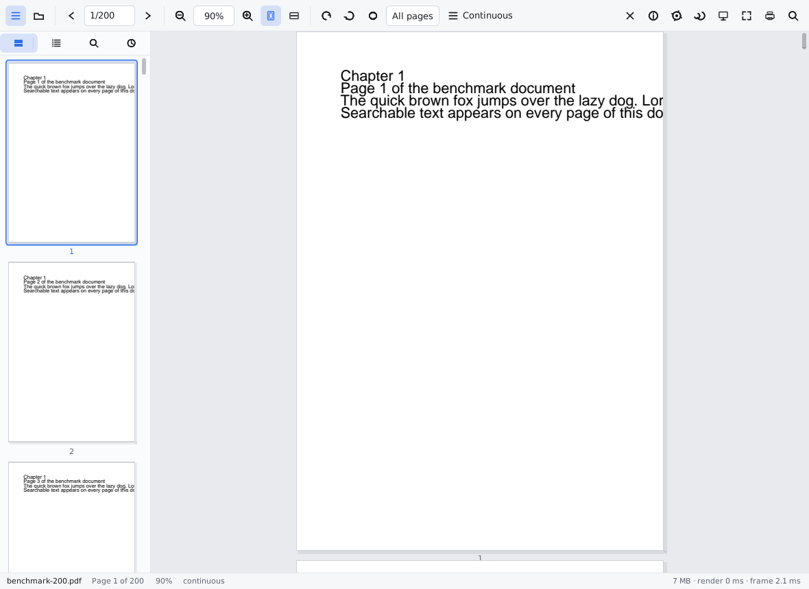

# pdf-rust

A fast, small, native PDF reader for **Windows 10/11** and **Linux**, written in
Rust with **zero third-party crates**.

* Opens instantly and stays out of your way: one window, one toolbar, no web
  view, no telemetry, no background services.
* **Remembers where you stopped** — page, scroll offset, zoom, rotation and
  reading mode per document, restored after a restart, a crash or a reboot.
* Continuous and single-page reading with smooth (animated) scrolling,
  thumbnails, table of contents, full-text search, text selection and copy,
  rotation, printing and link handling.
* Light and dark themes, full-screen and presentation modes, keyboard-first.
* A steady frame costs **~1.6 ms** on a 200-page document (release build,
  1180×860) — see [Performance](#performance).

```
┌──────────────────────────────────────────────────────────────────┐
│ ☰  Open  ‹ ›  [page] / 20   −100%+  Fit  ⟳  🔍   ☾  ⛶            │
├───────────┬──────────────────────────────────────────────────────┤
│ Thumbs    │                                                      │
│ Contents  │                  rendered PDF page                   │
│ Search    │                                                      │
│ Recent    │                                                      │
├───────────┴──────────────────────────────────────────────────────┤
│ document.pdf · Page 10 / 20 · 120% · continuous          12 MB   │
└──────────────────────────────────────────────────────────────────┘
```



<sub>Light and dark themes ([dark](docs/screenshots/dark.png)). Both frames were
painted by the viewer itself with `pdf-rust --screenshot`; see
[`scripts/screenshot.sh`](scripts/screenshot.sh).</sub>

## Status

Milestones 1–5 of the plan in [`DEVELOPMENT.md`](DEVELOPMENT.md) are implemented:
architecture, PDFium rendering, navigation/zoom/rotation, SQLite-backed reading
positions and the viewer chrome (thumbnails, outline, search, recent files) on
both platform shells. Packaging for `.deb`, AppImage, portable ZIP and NSIS
installer is in [`packaging/`](packaging). [`DEVELOPMENT.md`](DEVELOPMENT.md) is the
single source of truth for the current state; [`CHANGELOG.md`](CHANGELOG.md)
tracks releases.

## Requirements

| | Requirement |
| --- | --- |
| Build | Rust 1.75+ (`cargo`), no network needed (no dependencies) |
| Runtime | `libpdfium.so` (Linux) or `pdfium.dll` (Windows) |
| Persistence | `libsqlite3.so.0` / `winsqlite3.dll` (falls back to a session-only store if absent) |
| Linux GUI | X11 (`libX11.so.6`), no GTK/Qt needed |
| Windows GUI | user32/gdi32/comdlg32 (part of every Windows install) |

Fetch the PDF engine (pinned, checksum-verified, git-ignored):

```bash
./scripts/fetch-pdfium.sh            # Linux x64, Windows x64, or both
```

## Build

```bash
cargo build --release                # target/release/pdf-rust
cargo test                           # 144 tests, no display needed
./target/release/pdf-rust document.pdf
```

Release builds use fat LTO, one codegen unit, `panic=abort` and symbol stripping
(see `Cargo.toml`): the executable is ~1.7 MB.

## Install

Prebuilt packages are produced by the scripts in [`packaging/`](packaging); see
[`docs/packaging.md`](docs/packaging.md) for the full description.

* **Linux** — `scripts/build-release.sh` (or the two scripts individually) builds
  `dist/pdf-rust_<version>_amd64.deb` and an AppImage. The package installs
  `/usr/bin/pdf-rust`, ships PDFium in `/usr/lib/pdf-rust/`, registers
  `application/pdf` (desktop entry, MIME XML, AppStream metainfo, icon) and
  refreshes the caches from `postinst`.

  ```bash
  sudo dpkg -i dist/pdf-rust_0.1.0_amd64.deb
  ```

* **Windows** — `packaging\windows\build.ps1` runs the tests, builds the release
  binary, and produces `dist/pdf-rust-<version>-win64.zip` plus an NSIS installer
  (`makensis` required for the installer). The installer offers Start Menu and
  desktop shortcuts and an optional "Open PDF files with pdf-rust" association,
  and the executable carries the icon, version stamp and a per-monitor-DPI
  manifest.

## Usage

| Action | Shortcut |
| --- | --- |
| Open document | `Ctrl+O` (or drag & drop, or `pdf-rust file.pdf`) |
| Next / previous page | `→` / `←`, `Page Down` / `Page Up` |
| First / last page | `Home` / `End` |
| Go to page | `Ctrl+G` |
| Zoom in / out | `Ctrl++` / `Ctrl+-` (or `Ctrl`+wheel) |
| Fit page / fit width / 100% | `Ctrl+0` / `Ctrl+1` / `Ctrl+2` |
| Rotate clockwise / counter-clockwise | `Ctrl+R` / `Ctrl+Shift+R` |
| Continuous / single page | `Ctrl+M` |
| Search | `Ctrl+F`, `F3` / `Shift+F3` for next/previous match |
| Copy selection | `Ctrl+C` |
| Highlight selection | `Ctrl+H` |
| Print | `Ctrl+P` |
| Full screen | `F11`; presentation mode `F5` |
| Toggle sidebar | `F9` |
| Toggle theme | `Ctrl+D` |
| Close document | `Ctrl+W` |
| Quit | `Ctrl+Q` |

Command line:

```
pdf-rust [--db <path> | --no-db] [--page <n>] [--stats] [--selftest [doc.pdf]] [doc.pdf ...]
```

`--selftest` runs the real viewer headlessly (no window) and prints timing and
memory numbers; `--screenshot <out.png>` paints one frame headlessly and writes
it as a PNG (`--dark`, `--size 1280x800` and `--page <n>` apply); `--stats`
prints startup time and peak memory on exit.

## Performance

Measured with `--selftest` on a 200-page, 99 KB synthetic document, release
build, 1180×860 window (numbers from [`docs/testing.md`](docs/testing.md)):

| Stage | Cost |
| --- | --- |
| steady-state frame (chrome + 2 pages) | ~1.6 ms |
| page content | ~0.5 ms |
| sidebar with thumbnails | ~0.5 ms |
| toolbar | ~0.2 ms |
| status bar | ~0.05 ms |
| PDFium page render | ~0.1–0.3 ms |
| peak memory | ~18 MB |
| render cache | ~7 MB of the 192 MB budget |

Getting there meant removing three invisible costs (stroking that visited every
pixel of the page box, full-rectangle shadows, resampling thumbnails every frame);
[ADR 0005](docs/adr/0005-frame-budget.md) has the before/after table and the
reasoning.

## Documentation

* [`docs/architecture.md`](docs/architecture.md) — module map, frame lifecycle,
  state, threading, persistence, invariants.
* [`docs/testing.md`](docs/testing.md) — test layers, fixtures, headless
  performance checks, manual release matrix.
* [`docs/packaging.md`](docs/packaging.md) — artifacts, package contents, icons,
  resource embedding, version bumps.
* [`docs/adr/`](docs/adr) — architecture decision records: framework, PDF engine,
  UI rendering, persistence, frame budget, packaging.
* [`DEVELOPMENT.md`](DEVELOPMENT.md) — progress, known issues, next milestones.

## Privacy

Everything runs locally. No analytics, no telemetry, no network requests. The
reader never modifies your documents; rotated copies, print jobs and exports are
written to new files.

## Licence

MIT for the application code (see [`LICENSE`](LICENSE)). PDFium is BSD-3-Clause;
the embedded DejaVu Sans font is under the Bitstream Vera licence (see
`assets/fonts/DejaVuSans.LICENSE`).
