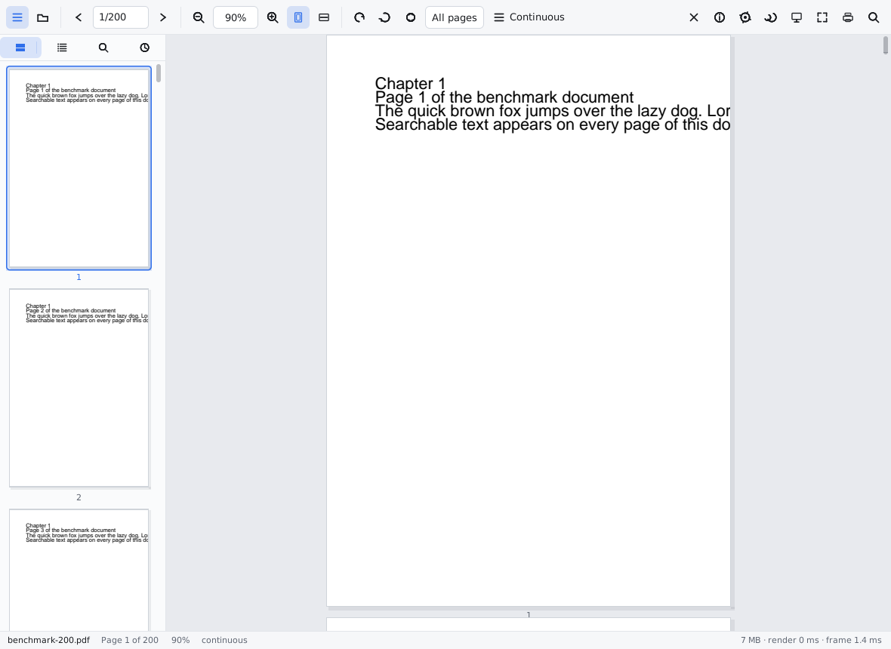

# pdf-rust 0.1.0

A fast, small, native PDF reader for Linux and Windows, written in Rust with
**zero third-party crates**. One window, one toolbar, no web view, no telemetry,
and it remembers exactly where you stopped — page, scroll offset, zoom, rotation
and reading mode, per document, across restarts and reboots.



## Download

Binaries are published in this tag under `downloads/v0.1.0/` and linked directly
below; the source archives are the ones GitHub generates for the tag.

| Artifact | Platform | Size | Direct download |
| --- | --- | --- | --- |
| `.deb` package | Debian / Ubuntu / Zorin, x86-64 | 3.3 MB | [pdf-rust_0.1.0_amd64.deb](https://github.com/ankitkumar131/pdf-rust/raw/v0.1.0/downloads/v0.1.0/pdf-rust_0.1.0_amd64.deb) |
| Portable tarball | any Linux x86-64 (glibc ≥ 2.31) | 4.2 MB | [pdf-rust-0.1.0-linux-x86_64.tar.gz](https://github.com/ankitkumar131/pdf-rust/raw/v0.1.0/downloads/v0.1.0/pdf-rust-0.1.0-linux-x86_64.tar.gz) |
| Checksums | — | 300 B | [SHA256SUMS.txt](https://github.com/ankitkumar131/pdf-rust/raw/v0.1.0/downloads/v0.1.0/SHA256SUMS.txt) |
| Source archive | — | 663 KB | [pdf-rust-0.1.0-src.tar.gz](https://github.com/ankitkumar131/pdf-rust/archive/refs/tags/v0.1.0.tar.gz) |

```bash
# verify what you downloaded
curl -LO https://github.com/ankitkumar131/pdf-rust/raw/v0.1.0/downloads/v0.1.0/SHA256SUMS.txt
sha256sum -c SHA256SUMS.txt
```

```
8835e65ff147bb5a61faaeb6d2168ac2186815226dc1eecdf4be6959f91c92e0  pdf-rust_0.1.0_amd64.deb
765a67538acf6d6cd81b9ccb0361c89cb2ade6ce18dc71dc428fd964b8f13d6b  pdf-rust-0.1.0-linux-x86_64.tar.gz
```

PDFium (the renderer) is bundled in both packages — nothing else to install.

> **Windows:** the Windows build is produced on Windows, because it needs the
> Windows resource compiler and `pdfium.dll`. Run
> `powershell -ExecutionPolicy Bypass -File packaging\windows\build.ps1` in a
> checkout of this tag; it creates `dist\pdf-rust-0.1.0-win64.zip` and, when NSIS
> is installed, `dist\pdf-rust-0.1.0-setup.exe`. No Windows binary or installer is
> attached to this release yet.

## Install

**Debian / Ubuntu / Zorin**

```bash
sudo dpkg -i pdf-rust_0.1.0_amd64.deb
sudo apt-get -f install          # only if dpkg reports missing dependencies
pdf-rust document.pdf
```

The package installs `/usr/bin/pdf-rust`, ships PDFium in
`/usr/lib/pdf-rust/`, and registers the desktop entry, icon, `application/pdf`
MIME type and AppStream metadata — pdf-rust appears in *Open with* and can be
chosen as the default PDF application.

**Portable**

```bash
tar -xzf pdf-rust-0.1.0-linux-x86_64.tar.gz
cd pdf-rust-0.1.0-linux-x86_64
./pdf-rust document.pdf          # runs in place, no root, no LD_LIBRARY_PATH
./install-desktop.sh             # optional: add it to the application menu
```

## Highlights

* **Reading position that survives everything** — page, scroll offset, zoom,
  rotation and reading mode are stored per document (SHA-256 identity, so a
  renamed or moved file keeps its place) in a WAL-mode SQLite database, autosaved
  every 2 s and on exit.
* **Fast** — ~1.6 ms steady-state frame on a 200-page document; first frame in
  ~5 ms once the renderer is mapped; idle at well under 1% CPU.
* **Small** — 1.71 MB stripped executable, 18 MB peak RSS on the benchmark
  document, no runtime besides X11 (or the Windows system DLLs).
* Continuous and single-page reading with smooth scrolling, thumbnails, table of
  contents, full-text search with next/previous, text selection and copy,
  highlights, rotation (page or all pages), links, presentation mode, printing.
* Light and dark themes, keyboard-first, full-screen, drag & drop, tabs for
  multiple documents, encrypted PDFs, graceful errors for corrupt files.
* All processing is local. No analytics, no network requests, and documents are
  never modified — rotated copies and print jobs go to new files.

## Keyboard

| Action | Shortcut |
| --- | --- |
| Open | `Ctrl+O` · Next / previous page `→` / `←` · First / last `Home` / `End` |
| Go to page | `Ctrl+G` · Zoom in/out `Ctrl++` / `Ctrl+-` (or `Ctrl`+wheel) |
| Fit page / width / 100% | `Ctrl+0` / `Ctrl+1` / `Ctrl+2` |
| Rotate / rotate all | `Ctrl+R` / `Ctrl+Shift+R` · Continuous or single page `Ctrl+M` |
| Search | `Ctrl+F`, `F3` / `Shift+F3` · Copy `Ctrl+C` · Highlight `Ctrl+H` |
| Print `Ctrl+P` · Full screen `F11` · Presentation `F5` · Sidebar `F9` | |
| Theme `Ctrl+D` · Close document `Ctrl+W` · Quit `Ctrl+Q` | |

## Requirements

| | |
| --- | --- |
| Linux | x86-64, glibc ≥ 2.31, `libX11.so.6`; `libsqlite3.so.0` optional (session-only without it) |
| Build | Rust 1.75+, no network access needed (no third-party crates) |
| Renderer | PDFium 152.0.7934 — bundled in the packages, BSD-3-Clause |

## Verify it works

Every artifact was smoke-tested before upload. You can repeat it:

```bash
pdf-rust --version
pdf-rust --selftest document.pdf     # headless: timings, memory, page count, text
pdf-rust --screenshot frame.png document.pdf
```

Reference numbers for the 200-page benchmark document, release build, 1180×860:

```
first frame        4.3 ms
document -> pixels 13.5 ms
frame (steady)     1.68 ms
page render        0.1 ms
page cache         6.9 MB
peak memory        17.8 MB
document           200 pages
text selection     ready
```

## Known limitations

* Linux only in this release's binaries; the Windows shell, installer and
  portable ZIP scripts are in the tree and type-checked on Linux
  (`cargo check --features win32-syntax-check`) but have not been run on Windows.
* The UI text has no hinting (slightly softer at 11 px) and no complex-script
  shaping; CJK appears as boxes in the chrome only — document text is rendered by
  PDFium and is unaffected.
* The X11 shell has not been exercised against a real X server in the development
  sandbox (no display); painting and interaction are covered by 146 headless
  tests.

## Documentation

* [README](https://github.com/ankitkumar131/pdf-rust/blob/v0.1.0/README.md) — features, build, usage
* [Architecture](https://github.com/ankitkumar131/pdf-rust/blob/v0.1.0/docs/architecture.md) · [Testing](https://github.com/ankitkumar131/pdf-rust/blob/v0.1.0/docs/testing.md) · [Packaging](https://github.com/ankitkumar131/pdf-rust/blob/v0.1.0/docs/packaging.md)
* [ADRs](https://github.com/ankitkumar131/pdf-rust/tree/v0.1.0/docs/adr) — framework, engine, rendering, persistence, frame budget, packaging
* [CHANGELOG](https://github.com/ankitkumar131/pdf-rust/blob/v0.1.0/CHANGELOG.md) · [Development log](https://github.com/ankitkumar131/pdf-rust/blob/v0.1.0/DEVELOPMENT.md)

## Licence

MIT for the application code. PDFium is BSD-3-Clause; the embedded DejaVu Sans
font is under the Bitstream Vera licence. Third-party notices are in
[LICENSE](https://github.com/ankitkumar131/pdf-rust/blob/v0.1.0/LICENSE).
