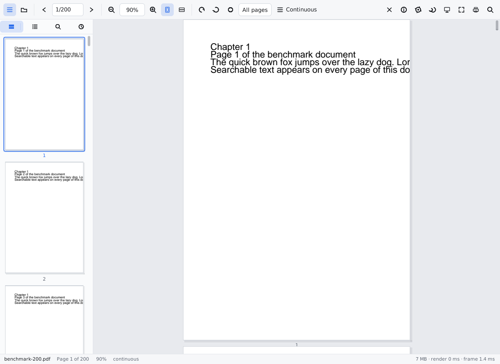

# pdf-rust 0.2.0

A reliability release. The reader now shares **one memory budget across every open
document**, recovers the **whole session** after a restart or a crash, treats a
damaged or hostile PDF as data rather than as trust, and keeps text readable when
the embedded font has no glyph for a character. Still one small native binary,
**zero third-party crates**, no web view, no telemetry; documents are never
modified.



## Download

Every artifact is attached to this release and covered by
[SHA256SUMS.txt](https://github.com/ankitkumar131/pdf-rust/releases/download/v0.2.0/SHA256SUMS.txt).

### Windows 10 / 11 (x64)

| Package | Direct download |
| --- | --- |
| Installer (shortcuts, uninstaller, *Open with pdf-rust*) | [pdf-rust-0.2.0-setup.exe](https://github.com/ankitkumar131/pdf-rust/releases/download/v0.2.0/pdf-rust-0.2.0-setup.exe) |
| Portable ZIP (unpack and run) | [pdf-rust-0.2.0-win64.zip](https://github.com/ankitkumar131/pdf-rust/releases/download/v0.2.0/pdf-rust-0.2.0-win64.zip) |

### Linux (x86-64)

| Package | Distribution | Size | Direct download |
| --- | --- | --- | --- |
| `.deb` | Debian, Ubuntu, Zorin | 3.27 MB | [pdf-rust_0.2.0_amd64.deb](https://github.com/ankitkumar131/pdf-rust/releases/download/v0.2.0/pdf-rust_0.2.0_amd64.deb) |
| Portable tarball | any distribution (glibc ≥ 2.31) | 4.22 MB | [pdf-rust-0.2.0-linux-x86_64.tar.gz](https://github.com/ankitkumar131/pdf-rust/releases/download/v0.2.0/pdf-rust-0.2.0-linux-x86_64.tar.gz) |

### Source

| | Size | Direct download |
| --- | --- | --- |
| Source archive (tag `v0.2.0`) | 685 KB | [pdf-rust-0.2.0-src.tar.gz](https://github.com/ankitkumar131/pdf-rust/releases/download/v0.2.0/pdf-rust-0.2.0-src.tar.gz) |
| Checksums | | [SHA256SUMS.txt](https://github.com/ankitkumar131/pdf-rust/releases/download/v0.2.0/SHA256SUMS.txt) |

```bash
# verify every download at once
curl -LO https://github.com/ankitkumar131/pdf-rust/releases/download/v0.2.0/SHA256SUMS.txt
sha256sum -c SHA256SUMS.txt
```

All packages bundle PDFium 152.0.7934 — no separate renderer install, no
`LD_LIBRARY_PATH`, no GTK/Qt.

## Install

**Windows — installer**

Download `pdf-rust-0.2.0-setup.exe` and run it. It installs into
`%ProgramFiles%\pdf-rust`, adds Start Menu (and optionally desktop) shortcuts, an
uninstaller, and an optional *Open PDF files with pdf-rust* component.

**Windows — portable**

```powershell
Expand-Archive pdf-rust-0.2.0-win64.zip -DestinationPath "$env:LOCALAPPDATA\pdf-rust"
& "$env:LOCALAPPDATA\pdf-rust\pdf-rust.exe" document.pdf
```

**Linux — Debian / Ubuntu / Zorin**

```bash
sudo dpkg -i pdf-rust_0.2.0_amd64.deb
pdf-rust document.pdf
```

**Linux — portable tarball**

```bash
tar -xzf pdf-rust-0.2.0-linux-x86_64.tar.gz
cd pdf-rust-0.2.0-linux-x86_64
./pdf-rust document.pdf          # runs in place, no root, no LD_LIBRARY_PATH
```

## What is new

### One memory budget for every document

Previously each document kept its own page cache, so ten open tabs could cost ten
times the memory. Now the caches are pooled behind a single budget — 192 MiB by
default, adjustable between 64 MiB and 2 GiB in **Settings → Memory** — and the
eviction order is deliberate:

1. background documents shrink to the page they were left on (switching back is
   still instant);
2. the active document gives up the least-recently-used pages that are not on
   screen;
3. only then are background thumbnails dropped.

The page you are looking at is never evicted. The status bar shows
`cache used/budget · pages · frame time` plus a coloured dot when usage passes
70 % (*elevated*) or 92 % (*critical*), and **Document information** (Ctrl+I) adds
a memory panel: usage bar, evictions, peak process memory and a per-document
breakdown.

### The whole session comes back

Tabs, tab order, the active tab, the sidebar panel and its width, and the window
position and size are stored as they change and restored on the next start. A
`session.clean` flag distinguishes a normal exit from a crash or a kill: a run
that ended unexpectedly is restored as-is, and documents that have since been
deleted are quietly dropped from the list instead of producing an error dialog
each.

### Text that degrades instead of vanishing

The embedded font covers Latin, Greek, Cyrillic and Hebrew. Characters outside it
used to disappear, which broke measurement as well as reading. Now typographic
quotes, dashes and ellipses fall back to ASCII, ligatures expand into their
letters, accented Latin letters fall back to their base letter, combining marks
are skipped (they carry no advance), and anything else draws the font's `.notdef`
box, so mixed-script labels keep their layout. Measuring and drawing share one
fallback path, so text no longer runs together or overlaps.

### Keyboard access

`Tab` and `Shift+Tab` walk every control on screen — including out of a text
field — and draw a focus ring; `Enter` or `Space` presses the focused control.
`Ctrl+Tab` still switches documents.

### Hardened against bad PDFs

* PDFium is initialised exactly once and now explicitly shut down on the way out;
  after that every entry point refuses to touch the library.
* A page tree that claims more than 200 000 pages is rejected before the per-page
  bookkeeping is allocated.
* A wrong password no longer becomes a fatal error dialog: the prompt re-opens
  with the field cleared so the password can simply be retyped, and cancelling
  closes only that tab.
* Rotated copies made for printing are written into a private `0700` temporary
  directory as a `0600` file with an unpredictable name, and deleted as soon as
  the spooler has them.
* External links remain limited to `http`, `https` and `mailto`; embedded
  JavaScript and launch actions are never executed, because the reader never asks
  the engine to run them.

## Highlights carried over from 0.1.0

* Reading position that survives everything — page, scroll offset, zoom, rotation
  and reading mode, per document, keyed by a SHA-256 fingerprint so a renamed or
  moved file keeps its place.
* ~1.4 ms steady-state frame and ~19 MB peak RSS on a 200-page document.
* Continuous and single-page reading with smooth scrolling, thumbnails, table of
  contents, whole-document search, text selection and copy, highlights, rotation,
  links, presentation mode, printing, tabs, encrypted PDFs.
* Light and dark themes (including the Windows title bar), full-screen, drag &
  drop, and one tiny binary (1.77 MB) with no runtime beyond X11 or the system
  DLLs.

## Keyboard

| Action | Shortcut |
| --- | --- |
| Open | `Ctrl+O` · Next / previous page `→` / `←` · First / last `Home` / `End` |
| Go to page | `Ctrl+G` · Zoom in/out `Ctrl++` / `Ctrl+-` (or `Ctrl`+wheel) |
| Fit page / width / 100% | `Ctrl+0` / `Ctrl+1` / `Ctrl+2` |
| Rotate / rotate all | `Ctrl+R` / `Ctrl+Shift+R` · Continuous or single page `Ctrl+M` |
| Search | `Ctrl+F`, `F3` / `Shift+F3` · Copy `Ctrl+C` · Highlight `Ctrl+H` |
| Print `Ctrl+P` · Full screen `F11` · Presentation `F5` · Sidebar `F9` | |
| Theme `Ctrl+D` · Close document `Ctrl+W` · Quit `Ctrl+Q` | |
| Focus next / previous control | `Tab` / `Shift+Tab` · Press `Enter` or `Space` |

## Requirements

| | |
| --- | --- |
| Linux | x86-64, glibc ≥ 2.31, `libX11.so.6`; `libsqlite3.so.0` optional (session-only without it) |
| Build | Rust 1.75+, no network access needed (no third-party crates) |
| Renderer | PDFium 152.0.7934 — bundled in the packages, BSD-3-Clause |

## Verify it works

```bash
pdf-rust --version
pdf-rust --selftest document.pdf     # headless: timings, memory, page count, text
```

Reference numbers for the 200-page benchmark document, release build, 1180×860
(one recorded run; the steady frame varies by about ±0.2 ms between runs):

```
first frame        7.7 ms
document -> pixels 11.8 ms
frame (steady)     1.36 ms
page render        0.2 ms
page cache         6.9 MB
peak memory        19.0 MB
document           200 pages
text selection     ready
```

## Tests

178 tests pass offline with no display and no warnings: 131 unit tests, 3 CLI
tests, 10 engine tests against real PDFium, 32 end-to-end viewer tests and 2
fixture generators (1 ignored). The new coverage is specific: the shared budget is
exercised with two documents that cannot both fit, `trim_to`/`keep_only` are
checked against LRU order and protected pages, session restore is verified across
simulated restarts including an unclean shutdown and a deleted document, the
password flow is driven with a real RC4-encrypted fixture, and the private
temporary directory is checked for `0700`/`0600` permissions and cleanup.

## Known limitations

* The Windows binaries are built by the release workflow on Windows; the installer
  compiles cleanly, but the interactive parts (window, DPI scaling, clipboard,
  `Ctrl+P` printing, file associations) have not been verified on Windows hardware
  in this round.
* The X11 shell has not been exercised against a real X server in the development
  sandbox (no display); painting, focus traversal and interaction are covered by
  headless tests.
* Complex-script shaping is still limited: the chrome falls back per character
  (Arabic and CJK appear as boxes rather than joined/reordered text). Document
  content is rendered by PDFium and is unaffected.
* Rotated or page-managed exports only reorder/rotate; the original file is never
  rewritten.

## Roadmap

The next round is about the features that were deliberately left out of this
reliability release: full annotations (colours, underline/strikethrough, sticky
notes, freehand, edit/delete, annotation export), page management (extract, merge,
split, reorder, delete, rotate — always to a new file), optional OCR that keeps
the baseline memory footprint unchanged, richer reading modes (two-page spread,
cover page, RTL, focus mode, per-document background), and a document library with
bookmarks, progress, collections and metadata search. Aggregate crash-safe
recovery of a session that was cut off mid-write is also on the list.

## Documentation

* [README](https://github.com/ankitkumar131/pdf-rust/blob/v0.2.0/README.md) — features, build, usage
* [Architecture](https://github.com/ankitkumar131/pdf-rust/blob/v0.2.0/docs/architecture.md) · [Testing](https://github.com/ankitkumar131/pdf-rust/blob/v0.2.0/docs/testing.md) · [Packaging](https://github.com/ankitkumar131/pdf-rust/blob/v0.2.0/docs/packaging.md)
* [CHANGELOG](https://github.com/ankitkumar131/pdf-rust/blob/v0.2.0/CHANGELOG.md) · [Release 0.1.0](https://github.com/ankitkumar131/pdf-rust/blob/v0.1.0/docs/release-0.1.0.md)

## Licence

MIT for the application code. PDFium is BSD-3-Clause; the embedded DejaVu Sans
font is under the Bitstream Vera licence. Third-party notices are in
[LICENSE](https://github.com/ankitkumar131/pdf-rust/blob/v0.2.0/LICENSE).
