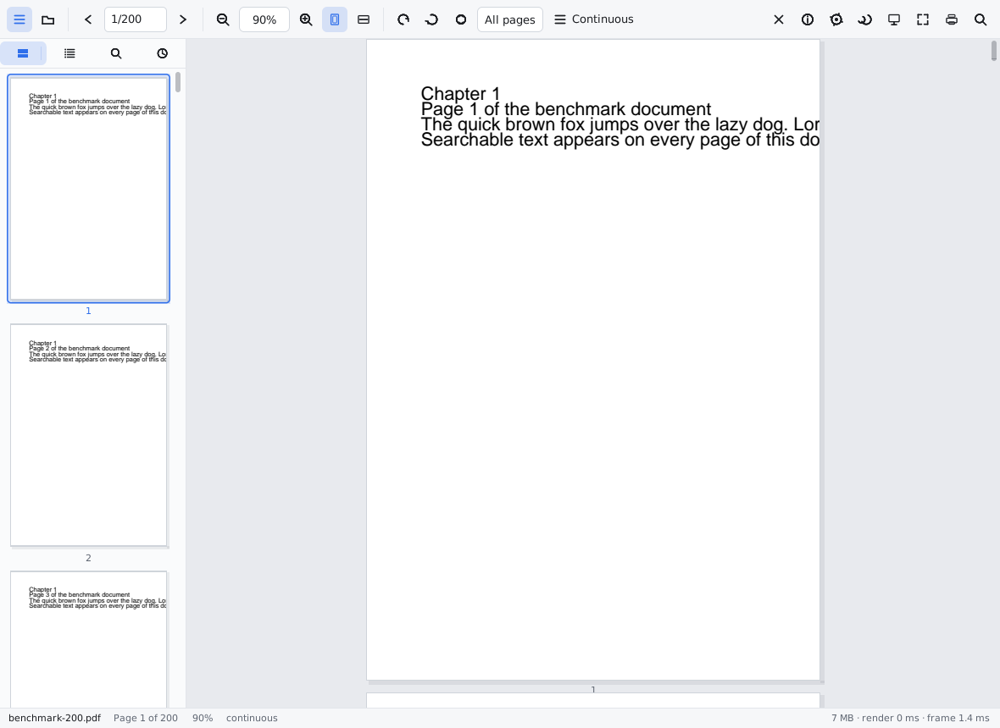

# pdf-rust 0.2.1

A patch release that fixes **password-protected PDFs**, which could not be opened
in 0.2.0, and masks the password while it is typed. Everything else is unchanged
from [0.2.0](https://github.com/ankitkumar131/pdf-rust/releases/tag/v0.2.0): one
shared memory budget for every document, full session recovery, the hardened PDF
boundary and per-glyph text fallback.



## Fixed

### A protected document now opens when the password is correct

The prompt dismissed itself *before* the "password submitted" action reached the
app. The handler looked for the prompt to read the password from, found nothing,
and sent nothing to the PDF engine — so the tab stayed on the *Password required*
placeholder no matter how often the right password was typed. (The password was
accepted silently and thrown away.)

The prompt now stays on screen until the action is handled, and the action
carries both the document it belongs to and the typed password, so it can no
longer be a no-op:

* **Unlock** or **Enter** sends the password to the engine, the tab shows its
  loading state, and the page is painted as soon as the engine answers;
* a **wrong** password re-opens the prompt with the field cleared and an
  explanation, instead of becoming a fatal error dialog;
* an **empty** field is reported in the prompt instead of being sent;
* a successful unlock clears the stale error, so the placeholder cannot outlive
  the unlock;
* **Cancel** still closes only the tab of the document that could not be opened;
* the prompt is dismissed when the document opens through any other path (for
  instance the session restored at startup).

### The password field masks what is typed

The field used to paint the password in clear. It now draws one bullet per
character, measured through the same glyph path as ordinary text, so the caret,
the selection highlight and the scroll-into-view behaviour stay exact. Nothing
that is typed is ever rasterised, and only the length is visible.

## Download

Every artifact is attached to this release and covered by
[SHA256SUMS.txt](https://github.com/ankitkumar131/pdf-rust/releases/download/v0.2.1/SHA256SUMS.txt).

### Windows 10 / 11 (x64)

| Package | Direct download |
| --- | --- |
| Installer (shortcuts, uninstaller, *Open with pdf-rust*) | [pdf-rust-0.2.1-setup.exe](https://github.com/ankitkumar131/pdf-rust/releases/download/v0.2.1/pdf-rust-0.2.1-setup.exe) |
| Portable ZIP (unpack and run) | [pdf-rust-0.2.1-win64.zip](https://github.com/ankitkumar131/pdf-rust/releases/download/v0.2.1/pdf-rust-0.2.1-win64.zip) |

### Linux (x86-64)

| Package | Distribution | Direct download |
| --- | --- | --- |
| `.deb` | Debian, Ubuntu, Zorin | [pdf-rust_0.2.1_amd64.deb](https://github.com/ankitkumar131/pdf-rust/releases/download/v0.2.1/pdf-rust_0.2.1_amd64.deb) |
| AppImage | any distribution, no install | [pdf-rust-0.2.1-x86_64.AppImage](https://github.com/ankitkumar131/pdf-rust/releases/download/v0.2.1/pdf-rust-0.2.1-x86_64.AppImage) |
| Portable tarball | any distribution (glibc ≥ 2.31) | [pdf-rust-0.2.1-linux-x86_64.tar.gz](https://github.com/ankitkumar131/pdf-rust/releases/download/v0.2.1/pdf-rust-0.2.1-linux-x86_64.tar.gz) |

### Source

| | Direct download |
| --- | --- |
| Source archive (tag `v0.2.1`, generated by GitHub) | [pdf-rust-0.2.1.tar.gz](https://github.com/ankitkumar131/pdf-rust/archive/refs/tags/v0.2.1.tar.gz) |
| Checksums for every binary above | [SHA256SUMS.txt](https://github.com/ankitkumar131/pdf-rust/releases/download/v0.2.1/SHA256SUMS.txt) |

## Install

**Windows — installer**

Download `pdf-rust-0.2.1-setup.exe` and run it. It installs into
`%ProgramFiles%\pdf-rust`, adds Start Menu (and optionally desktop) shortcuts, an
uninstaller, and an optional *Open PDF files with pdf-rust* component.

**Windows — portable**

```powershell
Expand-Archive pdf-rust-0.2.1-win64.zip -DestinationPath "$env:LOCALAPPDATA\pdf-rust"
& "$env:LOCALAPPDATA\pdf-rust\pdf-rust.exe" document.pdf
```

**Linux — Debian / Ubuntu / Zorin**

```bash
sudo dpkg -i pdf-rust_0.2.1_amd64.deb
pdf-rust document.pdf
```

**Linux — AppImage**

```bash
chmod +x pdf-rust-0.2.1-x86_64.AppImage
./pdf-rust-0.2.1-x86_64.AppImage document.pdf
```

**Linux — portable tarball**

```bash
tar -xzf pdf-rust-0.2.1-linux-x86_64.tar.gz
cd pdf-rust-0.2.1-linux-x86_64
./pdf-rust document.pdf          # runs in place, no root, no LD_LIBRARY_PATH
```

All packages bundle PDFium 152.0.7934 — no separate renderer install, no
`LD_LIBRARY_PATH`, no GTK/Qt.

## Try it

```bash
pdf-rust --version                       # pdf-rust 0.2.1
pdf-rust locked.pdf                      # prompts, then opens
pdf-rust --selftest document.pdf         # headless: timings, memory, page count
```

## Tests

180 tests pass offline with no display and no compiler warnings: 131 unit tests,
3 CLI tests, 10 engine tests against real PDFium, 34 end-to-end viewer tests and
the fixture generators. The password flow has three of them, all driven through
the real UI rather than by calling the handler directly — the previous round's
test did call the handler directly, which is exactly why it missed this bug:

* typing the password character by character and pressing `Enter` opens the
  document;
* a wrong password re-opens the prompt without a fatal dialog, a right one opens
  it, and cancelling closes only that tab;
* the prompt paints bullets: two different passwords of the same length produce
  pixel-identical frames, a longer password does not.

## Requirements

| | |
| --- | --- |
| Linux | x86-64, glibc ≥ 2.31, `libX11.so.6`; `libsqlite3.so.0` optional (session-only without it) |
| Build | Rust 1.75+, no network access needed (no third-party crates) |
| Renderer | PDFium 152.0.7934 — bundled in the packages, BSD-3-Clause |

## Known limitations

* The Windows binaries are built by the release workflow on Windows; the
  interactive parts (window, DPI scaling, clipboard, `Ctrl+P` printing, file
  associations) have not been verified on Windows hardware.
* The X11 shell has not been exercised against a real X server in the development
  sandbox (no display); painting, focus traversal and interaction are covered by
  headless tests.
* Complex-script shaping is still limited: the chrome falls back per character
  (Arabic and CJK appear as boxes). Document content is rendered by PDFium and is
  unaffected.
* Document permissions are not enforced beyond what the engine allows; owner-password
  restrictions on printing/copying are reported in the information dialog but not
  policed.

## Documentation

* [README](https://github.com/ankitkumar131/pdf-rust/blob/v0.2.1/README.md) — features, build, usage
* [Architecture](https://github.com/ankitkumar131/pdf-rust/blob/v0.2.1/docs/architecture.md) · [Testing](https://github.com/ankitkumar131/pdf-rust/blob/v0.2.1/docs/testing.md) · [Packaging](https://github.com/ankitkumar131/pdf-rust/blob/v0.2.1/docs/packaging.md)
* [CHANGELOG](https://github.com/ankitkumar131/pdf-rust/blob/v0.2.1/CHANGELOG.md) · [Release 0.2.0](https://github.com/ankitkumar131/pdf-rust/blob/v0.2.0/docs/release-0.2.0.md)

## Licence

MIT for the application code. PDFium is BSD-3-Clause; the embedded DejaVu Sans
font is under the Bitstream Vera licence. Third-party notices are in
[LICENSE](https://github.com/ankitkumar131/pdf-rust/blob/v0.2.1/LICENSE).
